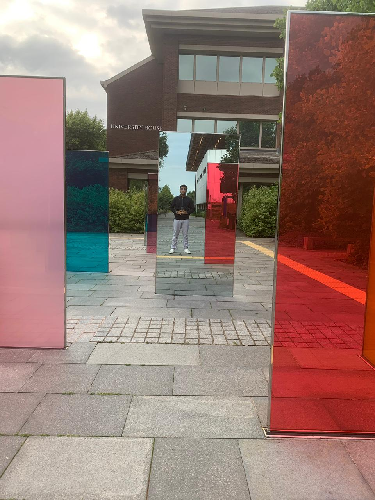
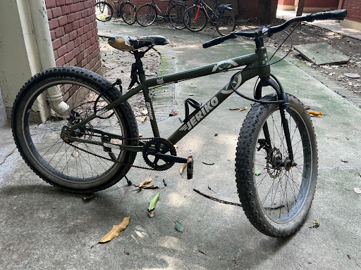
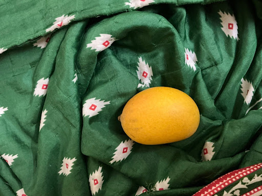

A first-person account of my time at IITK

   بِسْمِ ٱللّٰهِ ٱلرَّحْمَٰنِ ٱلرَّحِيم

My thanks to Mohammad Saad bhai, and Mahi from Vox, for coaxing me to write this with stick and carrot, just when I thought I had procrastinated beyond the point of no return. I promise this is not a representative sample of my writing because first, it is complete, and second, it had to be rushed to meet a deadline. Perhaps the two are linked.

Given a few more months, I should have written a literary marvel, a veritable Bildungsroman in essay form, but because of paucity of time, readers will have to content themselves with this shoddy collection of sketches.

The cover photo with this was chosen because it struck me as aptly symbolic. In the picture as in this essay, I catch myself reflecting on all that’s behind me (partly through rose tinted glass) while actually looking forward- onto what lies ahead (more uni). Here too perhaps I am posing, painting a more flattering portrait of myself than natural.

### Act I

Three years and some months have passed since I first came to Kanpur in the dying spring of Twenty Twenty Two. It was the day after April Fools’, and four months after the start of our unwilling subscription to the dullest of all streaming platforms, HelloIITK.

I do not have many memories of the Online Semester, except that it was a time of Procrastination and great Lethargy, not unlike the semesters that followed it. Yet I cannot forget the folly of sleeping through one too many PE101 quizzes, to which I owe the honour of experiencing that beloved IITK tradition offline in a later sem. I also remember having to google ways to speed up videos more than 2x, in order to match the alarming ratio of hours of video lectures left to those left till the exam. 

I was barely in contact with anyone from college, except through a few games of Smash Karts, in which I attribute my middling performance to the constraint of playing on a desktop. Unfortunately, this excuse could not work for academics when I discovered to my great surprise that getting an SPI above 9 was not a trivial task. At length, those four months passed, and I found myself excitedly looking forward to being on campus. 

Landing at the Kanpur airport, I was taken aback in quick succession at the lack of an aerobridge, an air conditioning system and a permanent roof. Now, the government has graciously endowed the city with a new airport, this time with AC and a solid roof, which no doubt does much to bolster the first impression of a city known primarily for its consumption of paan masala. As we traversed the Grand Trunk road for the first time of many, the chaos of the city was on full display. The heat, noise, and dirt made for a worrying prognosis, but I consoled myself with the thought that I would scarcely need to leave the campus. 

On reaching campus, we were obliged to make the customary first purchases- a bucket, a mattress and a bicycle. Understandably, the bulk of my excitement was reserved for the third item in this list. You see, with protective parents and a neighbourhood full of construction sites, I was denied the basic childhood pleasure of riding a bicycle, for a long time- this was to be my emancipation.

As I strolled through the steel steeds on offer in the parking space-turned-cycle shop, I was rather unimpressed. But finally, one rugged piece caught my eye, and I took a joyful test ride, pleased at the discovery that my cycling skills were intact despite years of disuse. This was to be my faithful companion through these years, never permanently stolen despite my aversion to cycle locks. In fact, a large number of those acts of temporary theft, or non-consensual borrowing as I liked to call it, were undertaken by the SIS security guards on the preemptive grounds that it might be stolen by someone else for once. I attach this photo partly as tribute to my loyal companion and partly in the hope I can finally get a decent offer to sell it.

When we were introduced early on to the campus ritual of ‘kholna’ or introducing oneself to seniors in chaste Hindi, I took the responsibility, as a member of the first batch, to coin a novel translation for our program name, Statistics and Data Science. I came up with Sankhyiki evam Tadad Shastra, which I circulated through the SDS Whatsapp group. When I later became an SG and a senior, I tried my best to pass this on to future batches, but I am informed that the prevalent coinage now is a six letter term with the 1st, 4th and 6th letters as S, D and S, referring to defecation.

Like many other batchmates coming straight from two years of confinement and ghee-laden parathas, I was quite solid. The famed mess of hall 13 came as a blessing in disguise to those of us gourmands- so many us regained our fitness even without the rigours of PE102, thanks to the satiety-inducing cuisine on offer.

The second semester too, passed in a somewhat similar fashion to the first, this time with the added benefit of company. Every time I dozed off, my roommate Biswas too would hear the call of goddess Nidra, and every time he headed to the canteen, my gluttony would be activated as well.

### Act II

Eventually, we came to hall 5. It is to me the most pleasant place on campus, and I don’t think I have unpleasant memories of it, except perhaps three incidents.

First, when, much to Biswas’ amusement, the punctilious dogs of hall 5 had me running like a madman for stepping into the quad lawn on their watch. In my defence, I was (and am) not really terrified of dogs, only disgusted by them, and at that time there had been several cases of barking dogs biting in the preceding weeks, giving me statistically significant reason to believe they had the same malicious intent with me, despite how the proverb may go. Thankfully, the dogs graciously let me off, confiscating only my slipper as fine.

Second, when a biblical flood enveloped the hostel during one summer break and destroyed a carton full of my precious books, left outside by the petty negligence of some retarded wingie I had entrusted it to.

Third: as I left the hostel mess one day after lunch with a couple of bananas for later, I noticed a huge monkey across the courtyard looking me in the eye and walking parallel to me. I nonchalantly tried to walk away, but then noticed it running laterally towards me. I sprinted, got on my cycle and rode away for my life, returning only once the guard at the gate convinced me my simian adversary was gone. 

But lest the reader believe I only had unpleasant experiences of being chased by mammals in Hall V, I should also relate happy occurrences. For example, I managed one night to extract my revenge on monkeys by stealing this sumptuous mango that had been dropped by some monkey during his fruit gathering ventures. It could only protest by chimping out loudly as I ran away with it.

But enough of monkeys and fruits, let’s head back to maths and stats. My academic initiation to my discipline of choice began with a disastrous third semester which I spent in so great a terror of Baby Rudin that I refused to read it at all except a few hours before exams. Fortunately, as I only discovered two and a half years later, the problem was not so much in my mathematical ability as in the instructor’s style. You see, the instructor not only made the mistake of assuming knowledge of all that was probably taught in MTH101 (I couldn’t tell for sure), but also things that were supposed to be taught in his own course. I am very confident that I can comfortably bag an A if I take the course on real analysis now, but I am told they won’t let me. Such are the injustices of life.

Finally in my fourth semester, with some amazing teachers like Prof Kundu and Prof Vats, I convinced myself that this was not such a bad idea. This was also the time when, despite advice to the contrary, I decided to enroll in a course on Natural Language Processing. I learned a lot despite the course and a bit due to it. There was a competition involving training neural nets to perform sentiment classification and translation which I would credit with finally forcing me to learn PyTorch after several dalliances with ML through famously educational SnT projects (the then recently launched ChatGPT played a substantial role too). However, the most unique feature of this course was its non-monotonous grading- despite faring better than my friends in each exam, competition and doing more in the group project, I somehow got a worse grade. 

This course had two favourable consequences. First, I averted the fate of some of my friends who were tempted into working in that lab. Without elaborating, I will only mention that there are at least three different individuals with whom I have bonded with, over shared resentment of the PI.

But more importantly, it gave me unreasonable confidence that I could tackle NLP adjacent problems pretty well. This proved pivotal in my internship recruitment drive. By the fourth semester I had barely done any of the regular preparation done for internships. I had tried out competitive programming but gave up within weeks, partly because the entire rat race around it brought back some of my JEE trauma, but mainly because I was lazy. To top it all, I had a mediocre grade that barely crossed the threshold for most sought-after firms, and would probably have been a hindrance at most of them.

Yet I was foolhardy enough to believe that I would somehow land an internship thanks to my earnest study and projects in statistics and ennelpee. If I didn’t land an internship here, research internships were a comfortable backup. Or so I thought. Little did I know that Canada and India would have a diplomatic fallout the same year, which was what possibly led to the MITACS program being downsized (and eventually shelved) for Indian students. 

As Bismarck is often falsely quoted to have said, God has a special providence for drunkards, fools and the United States of America. Proudly belonging to the second category, I owe much of my career to the grace of God. I’m quite convinced my admission here and elsewhere, and my getting an internship on the first day of the recruitment drive are best explained as consequences of divine intervention. As a side note, fortunately or unfortunately, the third entity in Bismarck’s apocryphal saying seems to be losing the Mandate of Heaven.

If there’s something of my own other than divine intervention, it’s an element of pricing. In quant lingo, “pricing” refers to guessing or estimating the true value or utility of an opportunity. Many decisions can (not should) be viewed as pricing the expected values of the different options and, based on these estimates, allotting your time and effort like a portfolio.

As I learnt about the stats of those who previously landed roles at day one companies, I began to question my optimism. But eventually, the opportunity I was anxiously waiting for arrived. By divine intervention, there appeared a firm with a data science/NLPish assessment- building an agent to play hangman. This was far less random than online assessments, which I anyways sucked at. 

This was my one chance- as I guessed, correctly, the expected payoff would be better for focusing on the one firm that had a selection process which suited my strengths. I had also correctly guessed that most other folks with the technical ability to tackle the problem wouldn’t bother giving it as much importance, because they stood a chance at other lucrative options.

The very day we were told about the task, I started working on the task. We hadn’t yet received the problem statement or code yet- I built up my own simple hangman server with a dictionary downloaded from the internet. After a week or so of endless tweaks and iteration, and attempts at running poorly optimised code on three of my friends’ laptops in parallel, I came up on top in the college, and eventually ended up getting an offer. Whatever happened after this is a long but (in my opinion) interesting story that is best told with details that may get me sued.

### Act III

In what was supposed to be my seventh semester, I took a sabbatical from IITK. I went for a research internship at the University of Warwick in England, but not before some struggle with red tape that served as a timely reminder of the unique propositions of Indian academia. I had attempted to avail the much celebrated academic flexibility of IIT Kanpur in the form of “internship credits”, but the department insisted that I would have to fly back for a day or two just to record my biometric attendance. I gave up and took leave for a semester instead.

But it was completely worth it. It allowed me to take a break from the chaotic flow of eternal busyness and reevaluate my priorities. It was at a crucial time in my life- it enabled me to make an informed decision between going for grad school and getting a job straight out of college. An uninspiring tryst with quantitative finance in the months prior made the decision easier. 

My stint in research was quite refreshing. Unlike my previous experiences in coursework and quant research, here I was forced to go in depth on the subject matter and to try to be original. Working on an open-ended problem is a very different ball game, and although (or rather, because) I found it challenging, it was intellectually stimulating. It is not a coincidence that when I returned to IITK, I bagged a near-perfect grade in my final semester despite, or perhaps due to, having five MTH courses.

In this context I owe a lot to Dr Dootika Vats, who advised and nurtured my nascent interest in stats and research from the very beginning. The three courses she instructed were unquestionably the best ones I experienced here, and have indelibly shaped my interests. Unfortunately, I never actually got to work on actual research with her, and as I joked in our last meeting, was an Eklavya to her Guru Dronacharya.

During my internship experience at Warwick, meeting people from so many different countries, with entirely different outlooks on life burst the bubble I’d been living in here. Most people here are preoccupied with signaling rather than learning- decisions from coursework to clubs are made based on how they would decorate a resume. The internship cohort, on the other hand, was full of intellectually curious folks who recognised a world beyond Faustian quant jobs. Theirs wasn’t a lack of ambition, but rather ambition in its purest form, directed towards an objective they were truly passionate about.

As much as we love to tout our purported eliteness, this spirit of pursuit of excellence is remarkably rare on campus. The prevailing ethos is to do the bare minimum to get one’s desired employment, through well-trodden pathways set as if in stone. There’s very little individuality or depth of personality amongst our cohort of students. Even ideas of fun are limited to a dozen or so linear combinations of gluttony, inebriation and unruliness. 

It will be remiss of me not to mention quizzing here. It is one of the few things that I did here, and that I had fun doing. The most precious thing I have so far from my stint is not my coordinator certificate – I have not been able to locate it yet- or my inter IIT medals -the cultural meet does not give out medals. In absence of such paraphernalia, the best thing I have is the far more precious acquaintance of a bunch of idiosyncratic fellows. I was never perhaps a true-blue quizzer, but as a reader, I cherished the vanity and community afforded by quizzing. 

### Finale

As I reach the end of the college life cycle and sit on the other side of coordie interviews, I’m more convinced than ever that most of this vaunted “college life” was, for lack of appropriate translation, *moh maya*. Almost everything here is a simulation if not a simulacrum- the job grind, clubs, positions of responsibility, even the entire conception of fun- superficial pursuits people blindly predicate their identities upon because others do too.

If I have one piece of advice, it is this: get a life. Don’t be one of those insufferable snobs who, even as they’re about to graduate, let their JEE rank, PoR, CPI, Codeforces rating or CTC dictate their identity and personality.

Cultivate taste. For art, for work, for poetry, for people, for buildings, for books, for music, for food. Most people today are NPCs whose preferences are dictated by mimetic desire and the Invisible Hand of capitalism- they “like” whatever is popular and sells (and often, signals status). Don’t be like them.

Don’t fall into the trap of endless consumption- food, movies, intoxicants, reels, even Youtube videos that appear informative. It will fry your brain. Try doing more active stuff like reading (real literature not self-help smut for god’s sake) and rekindle your innate curiosity, if that’s something that was destroyed by years of JEE and IIT “education”.

Try your hand at creative pursuits like thinking, writing, knitting, hacking, whatever. You may not realise it, but you can just create all kinds of stuff from thin air- from crocheted caps to webapps. It is exhilarating and cathartic. Unfortunately there are few, if any, good avenues for such pursuits on campus, but the internet has made finding your corner not too difficult. 

Try to learn new languages – one of my greatest regrets is that I spent four years here having learnt only one language, Persian, that too at a very rudimentary level. I tried unsuccessfully learning French through IITK’s Foreign Languages Program but it was online, clashed with one of my lab hours, and was full of weird aunties whose accents I couldn’t stand. I couldn’t even pick up our department’s national language, Bangla, though I very much intend to, for the same reason as I picked up Persian- its amazing corpus of poetry.

But all is not lost, and in one respect I am satisfied with my time as a student here. It is true that I may not have travelled and read and conversed as widely as I could have and ought to have. There is time yet, and I intend to make the most of it. I did however manage to become sufficiently intellectually and emotionally mature to have a semi-sane idea of what I like and what I lack, and thus perhaps what I want to do next.

As we leave, I am nostalgic, but not sentimental. I mourn the impending loss of intimate familiarity but I don’t wish its time had been longer. Perhaps the sweaty summer I spent here without air conditioning, in lieu of my semester abroad, has spoilt the finality of parting. 

I initially planned to write this in Hindi, but decided against it in order to conceal the shameful inadequacy of my command over my mother tongue. Nonetheless, my emotions are best captured by this famous ghazal of Iqbal, which I planned to recite at the department farewell . Unfortunately, my plan was thwarted by my aversion to confrontation and the dogged occupation of the stage by a few singing enthusiasts whose melodiousness could not match their determination.

> Sitaaron se aage jahaan aur bhi hain,  
> Abhi ishq ke imtihaan aur bhi hain
>
> Tu shaheen hai parwaaz hai kaam tera,  
> Tere saamne aasmaan aur bhi hain.
>
> Agar kho gaya ik nasheman to kya gham,   
> Maqaamaat e aah o fughaan aur bhi hain.

> There are worlds beyond the stars yet,   
> And trials and labours for your love yet.
>
> You’re a falcon, born to soar and fly,  
> There are skies for you to conquer yet. 
>
> And if a nest is lost, why brood?  
> You have abodes aplenty to lament yet.

As for the place I will call my alma mater, I have a couplet attributed variously to Zauq Dehlvi and Bahadur Shah Zafar:

> Ye chaman yūn hi rahega aur hazāron bulbulen,  
> Apni apni boliyān sab bolkar ur jāyengi.

> This garden shall remain hence and a thousand nightingales,  
> Shall each sing their own song and fly off to their vale.

